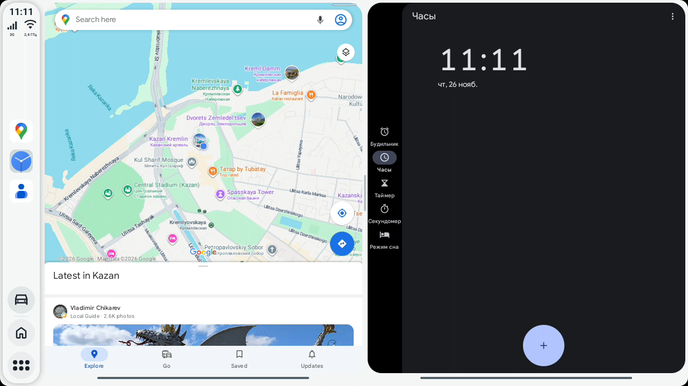
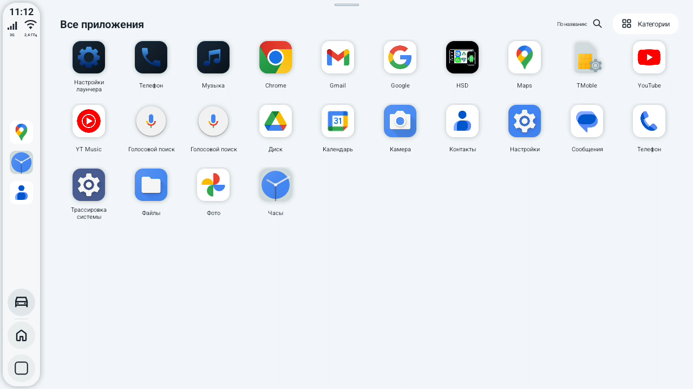
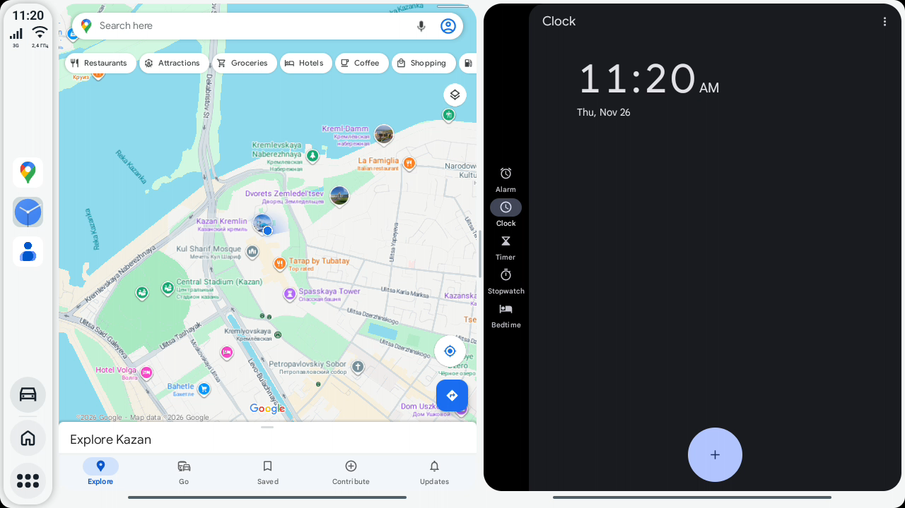
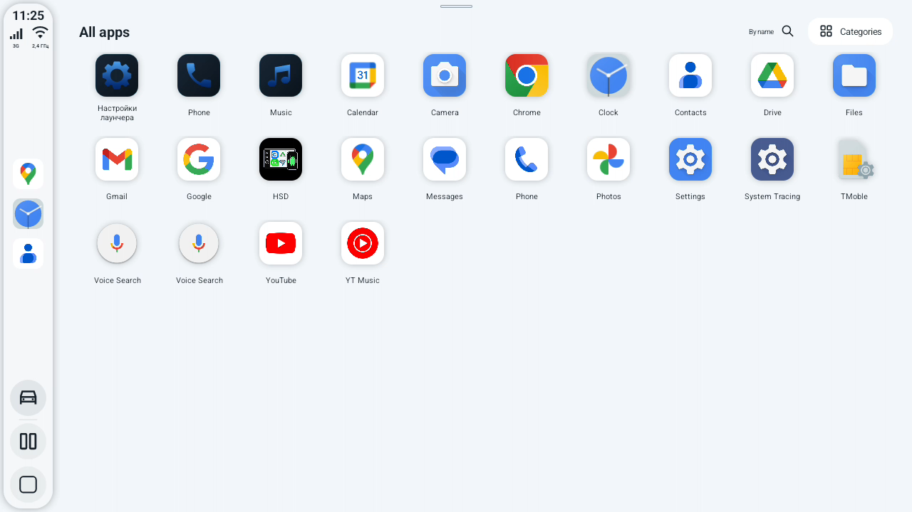

# HSD 0.8.4 · Изменения в выпуске

[English](#english)

Рабочий стол телефона в автомобиле. В этот выпуск входят **HSD 0.8.4 (167)** и автомобильный лаунчер **DriveDeck-HSD 0.7.4 (374)**.

**Android 11 и новее** · [Скачать HSD 0.8.4 (167)](https://github.com/SadykovIV/HSD/releases/download/v0.8.4/HSD-0.8.4-code167.apk) · [Скачать DriveDeck-HSD 0.7.4 (374)](https://github.com/SadykovIV/HSD/releases/download/v0.8.4/DriveDeck-HSD-0.7.4-code374.apk)

**Для работы Android Auto (AA) требуются действительные сертификаты AA, которые принимает магнитола.** Выданный вам ZIP установите в **Настройки → Сертификаты → Установить из ZIP**. В режиме Android Auto выберите установленный профиль и нажмите **Сохранить**.

### Что изменилось в HSD 0.8.4 и DriveDeck 0.7.4

1. **Больше способов подключиться**. Добавлены WeLink по USB, CarbitLink / EasyConnection по USB и Wi-Fi и экспериментальный ICCOA Carlink. Теперь DriveDeck можно попробовать и на магнитолах, у которых для связи с телефоном есть один из этих режимов. Для ICCOA на стенде по USB проверили изображение, касания, обложки и подсказки для приборной панели. По Wi-Fi проверили поиск и сопряжение.
2. **Android Auto возвращает изображение после камеры**. При возвращении из штатного меню или с камеры звук мог продолжаться, а экран оставался чёрным. Теперь, когда магнитола снова открывает Android Auto, HSD возобновляет показ рабочего стола в том же сеансе.
3. **Звонки с экрана автомобиля**. Во встроенном «Телефоне» DriveDeck доступны набор номера, контакты, избранное и недавние вызовы, при разблокированном телефоне и с разрешения Android. Входящий можно принять или отклонить на экране магнитолы. Для звонков из мессенджеров доступны действия, которые само приложение передаёт Android.
4. **Уведомления, с которыми можно работать**. Новые сообщения появляются по центру. Свайпните вниз из любой точки верхнего края, чтобы открыть шторку под пальцем. Карточку можно развернуть, нажать кнопку приложения или ответить прямо из неё, если приложение поддерживает быстрый ответ. Верхнюю полоску можно передвинуть или скрыть.
5. **Повторное подключение Android Auto по USB**. Android Auto различает отключение кабеля и временный уход в меню автомобиля. При настоящем обрыве HSD отправляет проигрывателю команду паузы. При быстром возврате кабеля приложение заново открывает соединение и учитывает уже выданный Android доступ к USB.
6. **Громкая связь отдельно от музыки**. В разделе «Звук» появился переключатель «Звук звонков в автомобиле». На Android 12 и новее разговор можно направить на автомобильный профиль звонков Bluetooth или на распознанное системой USB-устройство с микрофоном и динамиками. Для музыки можно выбрать другой выход.
7. **Музыка и голосовые подсказки**. В CarPlay исправлены пропуски, возникавшие при задержках звука на телефоне. Если для музыки выбран Bluetooth, HSD больше не запрашивает музыкальный канал у приёмника CarPlay. В проводном CarLife при снятии кабеля команда паузы уходит плееру сразу.
8. **Более отзывчивая карта**. В проводном CarLife при одновременной передаче изображения и звука в парном тесте медиана времени от касания до изменения картинки составила 147 мс после доработки и 161 мс до неё. В WeLink на стенде проверили масштабирование двумя пальцами и ведение карты одним пальцем после него. В Android Auto доработано попадание в кнопки по краям экрана.
9. **CarbitLink после звонка и при начале поездки**. Кнопка с машинкой сворачивает проекцию и сохраняет музыку. После разговора магнитола может открыть тот же рабочий стол и снова принимать касания. Для Wi-Fi можно выбрать Bluetooth автомобиля. При соединении с ним HSD ждёт EasyConnection до пяти минут и на Android 16 и новее может запросить включение точки доступа, если это разрешено системой.
10. **Возврат в CarbitLink по USB**. Если магнитола при повторном входе присылает данные от прошлого подключения, HSD сам повторяет попытку. На совместимом приёмнике рабочий стол можно снова открыть с магнитолы, оставив кабель на месте.
11. **Возврат картинки в CarLife**. После перезапуска видео магнитола снова получает полный кадр, даже если на экране неподвижная карта. По Wi-Fi она также может заново открыть прерванный канал.
12. **Беспроводной CarPlay в начале поездки**. HSD может начать подключение, когда телефон соединяется с выбранным Bluetooth автомобиля. Можно разрешить запуск для своей машины. Если Android ограничивает фоновый запуск, продолжить можно нажатием на уведомление.
13. **Разрешение и размер интерфейса**. В CarLife на главном экране HSD отображается размер видео текущего сеанса. Разрешение, размер интерфейса, частоту кадров и битрейт можно подобрать вручную. Размер кнопок и чёткость картинки можно настроить отдельно с учётом возможностей магнитолы.
14. **Подсказки и музыка на приборной панели**. В Android Auto доработана передача расстояния до манёвра вместе со стрелкой и улицей. В CarLife исправлена отправка обложки, когда плеер отдаёт её чуть позже названия трека. Что именно появится на приборной панели или HUD, определяет автомобиль.
15. **Виджеты и навигация в DriveDeck**. Нажатие на обложку открывает играющий плеер, если включена эта настройка. Для NavRadio+ отображаются название, частота и логотип станции. Исправлены запуск закреплённых приложений из дока и возврат из звонилки кнопкой «Домой», если она включена в настройках. Кнопку с машинкой можно скрыть.
16. **Клавиатура и затемнение телефона**. В DriveDeck откройте «Отображение → Клавиатура», чтобы выбрать ввод на телефоне или на магнитоле. Выбор применяется после переподключения, если Android поддерживает клавиатуру на внешнем дисплее. В режиме HSD «Затемнять экран» касания магнитолы сохраняют затемнение телефона.
17. **Установка сертификатов Android Auto**. В HSD есть единое место для ручной установки ZIP. В режиме Android Auto видны установленные профили и текущий выбор. Можно посмотреть сведения о сертификате и назначить отдельный профиль для каждой магнитолы.
18. **Первый запуск и настройки**. Мастер по очереди проводит через выбор рабочего стола, разрешения и активацию. При повторной активации по Wi-Fi можно использовать сохранённое сопряжение. Под параметрами изображения, звука, экрана телефона и обслуживания появились короткие пояснения.
19. **Скорость и OBD в DriveDeck**. Можно задать, при каком превышении ограничения скорости прозвучит предупреждение, от 0 до 20 км/ч сверх лимита. Если OBD-адаптер занят другим процессом DriveDeck, приложение показывает причину ожидания и повторяет подключение.
20. **Меньше лишней работы на телефоне**. Когда картинка неподвижна, HSD реже повторяет обработку одного и того же кадра. При передаче звука и видео стало меньше промежуточных копий. Время работы от батареи в автомобиле отдельно не измерялось.

### На экране магнитолы

| Два приложения рядом | Каталог приложений DriveDeck |
| --- | --- |
|  |  |

Кадры получены по беспроводному CarLife на стенде Android 14. [Все снимки интерфейса, совместимость и первое подключение](README.md#gallery)

**Если HSD уже установлен.** Обновите оба официальных APK поверх установленных приложений. Сборки с той же подписью сохраняют настройки. Если Android сообщает о конфликте подписи, перед удалением старой установки сохраните нужные данные. После обновления повторите активацию, если HSD её запросит.

## English

Run your phone’s apps on the car display. This release includes **HSD 0.8.4 (167)** and the **DriveDeck-HSD 0.7.4 (374)** car launcher.

**Android 11 or later** · [Download HSD 0.8.4 (167)](https://github.com/SadykovIV/HSD/releases/download/v0.8.4/HSD-0.8.4-code167.apk) · [Download DriveDeck-HSD 0.7.4 (374)](https://github.com/SadykovIV/HSD/releases/download/v0.8.4/DriveDeck-HSD-0.7.4-code374.apk)

**Android Auto (AA) requires valid AA certificates accepted by the head unit.** Install the ZIP issued to you under **Settings → Certificates → Install from ZIP**. Select the installed profile in Android Auto mode and tap **Save**.

### What changed in HSD 0.8.4 and DriveDeck 0.7.4

1. **More ways to connect**. Wired WeLink, USB and Wi-Fi CarbitLink / EasyConnection, and experimental ICCOA Carlink are now available. DriveDeck can use these modes on head units that offer them. Wired ICCOA tests covered video, touch, cover art and instrument cluster directions. Wireless tests covered discovery and pairing.
2. **Android Auto restores the picture after the camera**. Audio could keep playing while the screen stayed black after the car menu or reversing camera. When the head unit gives the display back to Android Auto, HSD now restores the desktop in the same session.
3. **Calls from the car screen**. DriveDeck’s Phone screen offers a keypad, contacts, favourites and recent calls when the phone is unlocked and Android grants access. Accept or decline an incoming call on the head unit. For messenger calls, the available controls depend on the actions the app supplies to Android.
4. **Notifications you can act on**. New messages appear in the centre. Swipe down anywhere along the top edge to open the shade where the gesture began. Expand a notification, use the app’s actions or reply inline if the app supports it. The handle can be moved or hidden.
5. **Reconnecting wired Android Auto**. Android Auto distinguishes an unplugged cable from a temporary switch to the car menu. If the connection is lost, HSD sends the player a pause command. When the cable is plugged back in, HSD reopens the connection and checks whether Android has already granted USB access.
6. **Hands-free calls independently of music**. Audio settings now have a separate call-audio switch. On Android 12 and later, calls can use the car’s Bluetooth hands-free profile or a USB device that Android recognises as having both a microphone and speakers. Music can use a different output.
7. **Music and spoken directions**. CarPlay handles the brief delays in phone audio that caused gaps in music and guidance. When Bluetooth is selected for music, HSD no longer requests a music channel from the CarPlay receiver. Wired CarLife sends the player a pause command as soon as the cable is unplugged.
8. **More responsive maps**. On the wired CarLife bench, median touch-to-picture latency under load was 147 ms after this change, down from 161 ms in the same test. In WeLink, bench tests covered pinch-to-zoom followed by a one-finger drag. Android Auto touch mapping at the edges of the display was also reworked.
9. **CarbitLink after a call and at the start of a trip**. The car button sends projection to the background and keeps music playing. After a call the head unit can reopen the same desktop and resume touch. For Wi-Fi, select the car’s Bluetooth device. When it connects, HSD waits up to five minutes for EasyConnection and can request a hotspot on Android 16 and later if the system allows it.
10. **Reopening wired CarbitLink**. If the head unit sends data from the previous USB connection on re-entry, HSD retries. A compatible receiver can now reopen the desktop from its own menu with the cable still plugged in.
11. **Picture recovery in CarLife**. After a video restart, the receiver gets a fresh full frame even on a stationary map. A wireless CarLife receiver can also reopen an interrupted channel.
12. **Wireless CarPlay at the start of a trip**. HSD can start connecting when the phone joins the car’s selected Bluetooth device. Enable this for your car. If Android restricts background launches, tap the notification to continue.
13. **Picture size and interface scale**. The HSD home screen shows the actual CarLife session resolution. You can adjust resolution, interface scale, frame rate and bitrate manually. This lets you change button size independently of picture sharpness, within the head unit’s capabilities.
14. **Directions and music on the instrument cluster**. Android Auto now handles the distance to a manoeuvre alongside the arrow and street name more reliably. CarLife handles cover art that arrives shortly after the track title. The car determines what its instrument cluster or head-up display can show.
15. **DriveDeck widgets and navigation**. Tapping the cover opens the active player when that option is enabled. NavRadio+ can show the station name, frequency and logo. Pinned dock apps launch correctly, the optional Home button works inside the dialer, and you can hide the car button.
16. **Keyboard and phone-screen dimming**. DriveDeck’s Display → Keyboard setting lets you choose the phone or head unit for text entry. Reconnect to apply the change. The head unit’s on-screen keyboard requires support from Android. Touching the head unit now preserves HSD’s phone-screen dimming.
17. **Installing Android Auto certificates**. HSD has one place to install an issued ZIP manually. Android Auto mode lists installed profiles and shows which is selected. You can inspect certificate details and assign a separate profile to each head unit.
18. **First-time setup and settings**. The wizard guides you through desktop selection, permissions and activation. Wi-Fi activation can reuse an existing pairing. Picture, audio, phone screen and maintenance settings now include short explanations below their names.
19. **Speed warnings and OBD in DriveDeck**. Choose how far over the speed limit you can go before a warning sounds, from 0 to 20 km/h. If another DriveDeck process is using the OBD adapter, the app explains the wait and retries.
20. **Less repeated work on the phone**. HSD processes fewer duplicate frames when the picture is still and makes fewer temporary copies of audio and video data. In-car battery life was not measured.

### On the head unit

| Two phone apps side by side | DriveDeck app drawer |
| --- | --- |
|  |  |

Frames decoded by a wireless CarLife receiver on the Android 14 bench. [Full screenshot gallery, compatibility and setup](README.en.md#gallery)

**Updating an existing install.** Install both official APKs over the installed apps. Packages signed with the same key retain their settings. If Android reports a signature conflict, save any data you need before removing the old install. Run activation again after the update if HSD prompts you.
