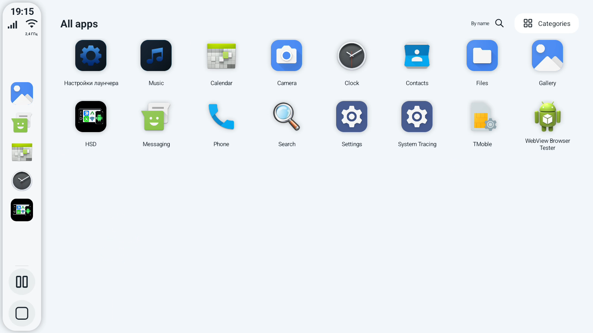
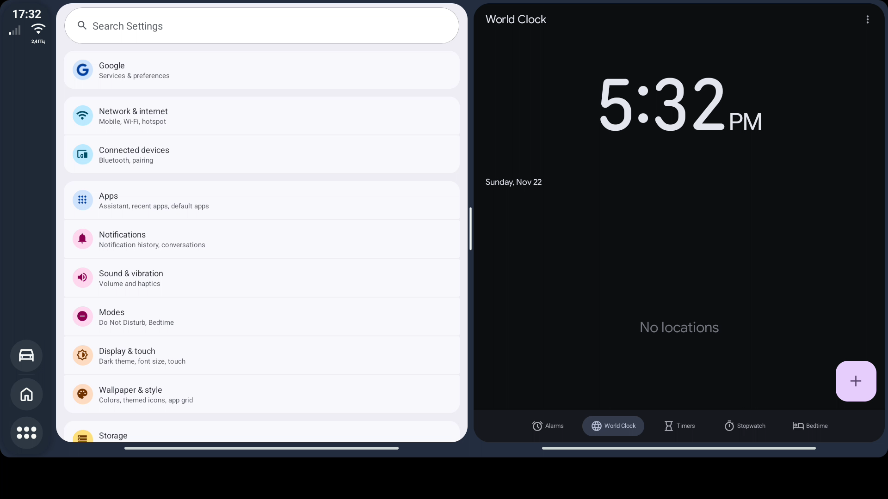
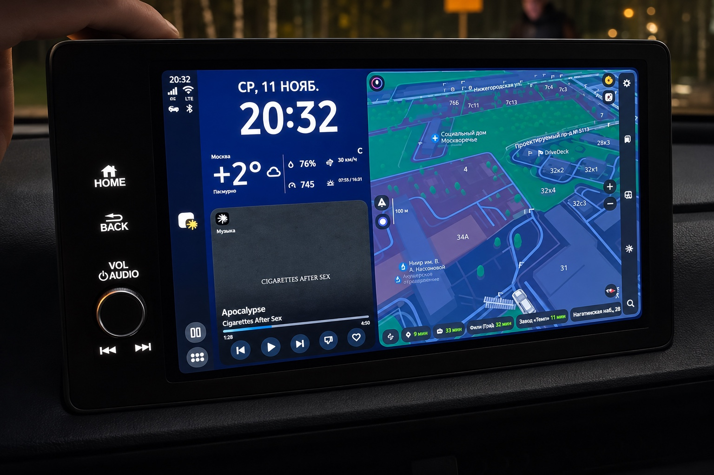
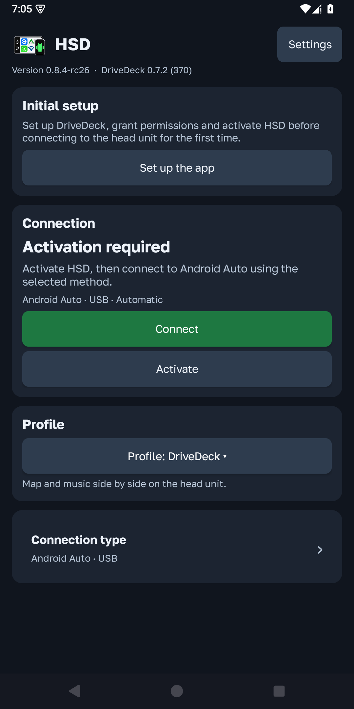
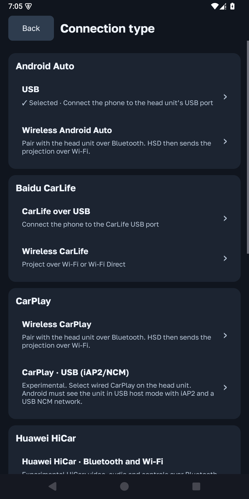
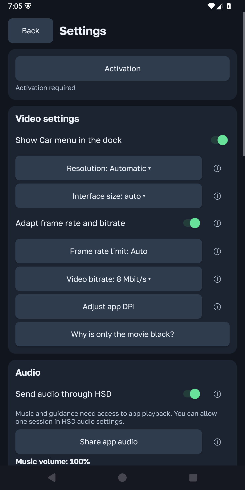
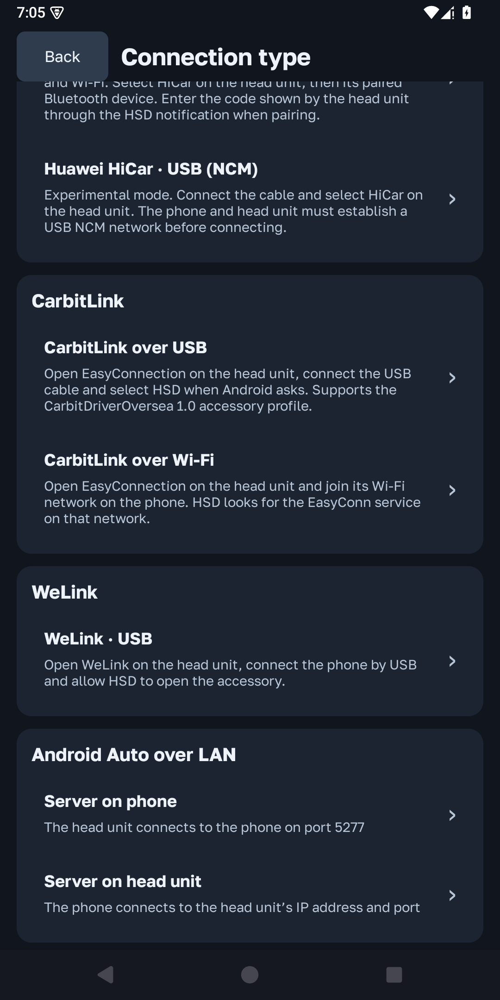

# HSD · HeadSwap Desktop

[Русский](README.md) · [Download HSD and DriveDeck](https://github.com/SadykovIV/HSD/releases/latest) · [4PDA discussion](https://4pda.to/forum/index.php?showtopic=1129468) · [Telegram group](https://t.me/+H2QUrHMGm-g3ODhi) · [Support via CloudTips](https://pay.cloudtips.ru/p/41f6ecdd)

HSD brings **DriveDeck, a full car launcher**, to your head unit. Launch apps installed on your Android phone directly on the car screen, including apps outside the Android Auto catalog. Open an app full screen or keep navigation and a music player side by side. Control them using the head unit’s touchscreen.

**Download for Android 10 or later** · [HSD 0.8.3 (115) APK](https://github.com/SadykovIV/HSD/releases/download/v0.8.3/HSD-0.8.3-code115.apk) · [DriveDeck-HSD 0.7.0 (362) APK](https://github.com/SadykovIV/HSD/releases/download/v0.8.3/DriveDeck-HSD-0.7.0-code362.apk)

## Supported protocols

The table compares **the public 0.8.3 release (115)** with **the 0.8.4 RC26 test build (146)**. RC26 requires Android 11 or later and DriveDeck-HSD 0.7.2 (370).

| Head unit protocol | HSD 0.8.3 | HSD 0.8.4 RC26 |
| --- | --- | --- |
| Android Auto | USB, Bluetooth + Wi-Fi, local network | USB, Bluetooth + Wi-Fi, local network |
| Baidu CarLife | USB, Wi-Fi | USB, Wi-Fi |
| Apple CarPlay | Bluetooth + Wi-Fi | Bluetooth + Wi-Fi, USB¹ |
| Huawei HiCar¹ | Bluetooth + Wi-Fi, USB (NCM) | Bluetooth + Wi-Fi, USB (NCM) |
| CarbitLink / EasyConnection¹ | — | USB, Wi-Fi |
| WeLink (Mapbar A1) | — | USB |

¹ Experimental mode. Wired CarPlay and CarbitLink have been tested on a bench. CarbitLink uses the car’s Bluetooth for music. Wired HiCar requires a head unit with USB NCM. A Honda SN‑3 owner confirmed wired WeLink on HSD 0.8.4 RC21 with an updated receiver.

On a local network, either the phone or the head unit can act as the Android Auto server.

## DriveDeck on the car display

DriveDeck 0.7.2 (370) on a test display. The split view shows Android Settings on the left and Clock on the right. This frame was captured over wireless Android Auto with HSD 0.8.4 RC26.

| Phone apps in DriveDeck | Two apps side by side |
| --- | --- |
|  |  |

See DriveDeck installed in a car

*Illustration based on the author’s photo, processed with AI.*

## HSD on the phone

These screenshots show HSD 0.8.4 RC26 with DriveDeck 0.7.2 on an Android 15 emulator. The home screen shows both app versions. Settings lets you adjust the picture and sound.

| Home | Connection type | Settings |
| --- | --- | --- |
|  |  |  |

More connection types — HiCar, CarbitLink, WeLink and Android Auto over LAN

On a fresh RC26 install, calls and notifications on the head unit, audio through HSD, separate navigation prompts and phone screen control start enabled. The setup wizard requests the required Android permissions in turn. Reactivating uses your saved choices, including Bluetooth for music.

With Android Desktop or DriveDeck, you can turn the phone screen off or let it time out. On Android 11–12, the phone firmware and each app determine which windows stay active while locked. If an app on the head unit stops updating, unlock the phone to resume it. If Android asks for access to app audio, open **Settings → Audio → Share app audio**. Permission lasts for one session. Samsung DeX is available on compatible Samsung phones.

## Connect your phone

1. Install **both APKs from the same release** on your phone. [Download HSD and DriveDeck](https://github.com/SadykovIV/HSD/releases/latest)
2. Open HSD, select **DriveDeck** and follow the setup wizard to grant permissions and activate HSD.
3. On the home screen, open **Connection type** and select a mode your head unit supports. Open that mode on the head unit. For a wired connection, use its projection USB port. If Android asks which app should handle wired Android Auto or CarLife, choose **HSD**.
4. For wired HiCar, select **Huawei HiCar · USB (NCM)**, save your choice, plug in the cable and tap **Connect**.

**If Android Auto requires a certificate issued to you**, select the profile from Android storage in 0.8.3. In RC26, open **Settings → Certificates → Install from ZIP**, select the installed profile and tap **Save**. You can save a different choice for each head unit.

**Upgrading from 0.7.3 or earlier?** Uninstall the old HSD and DriveDeck-HSD before installing the new versions. The signing key has changed. Uninstalling clears local settings, and you will need to activate HSD again.

[What changed in 0.8.3](CHANGELOG.md#changes-since-082) · [Known limitations](CHANGELOG.md#limitations) · [All releases and APKs](https://github.com/SadykovIV/HSD/releases)

## Credits

Thanks to YegorkaPomidorka for the Baidu CarLife implementation, RotkivKiv for DriveDeck, and the Android Auto and CarPlay contributors.
