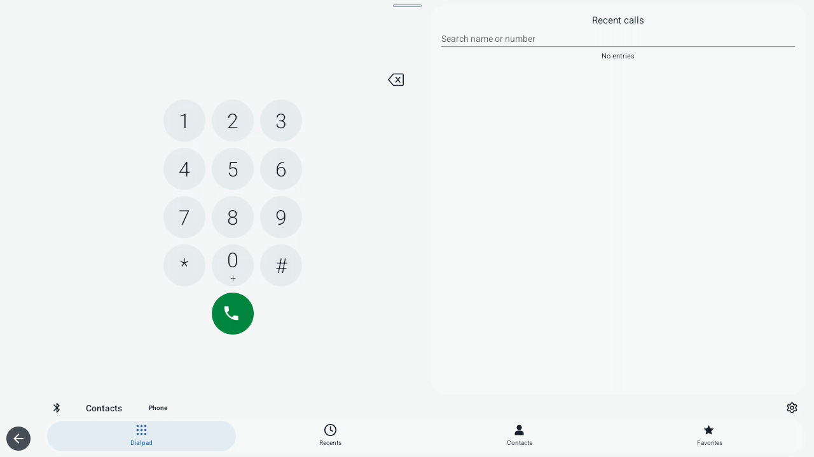
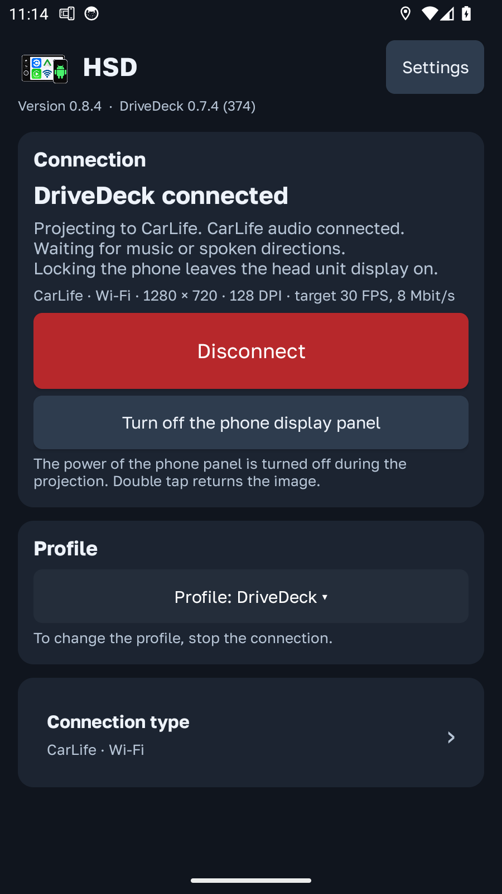
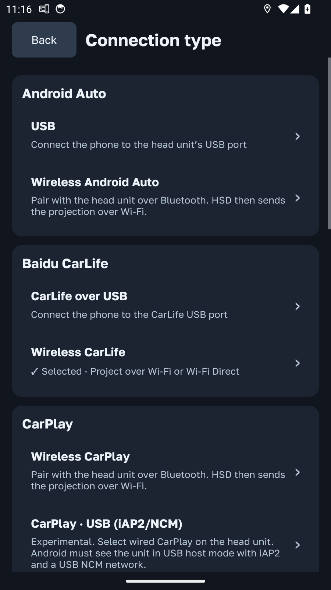
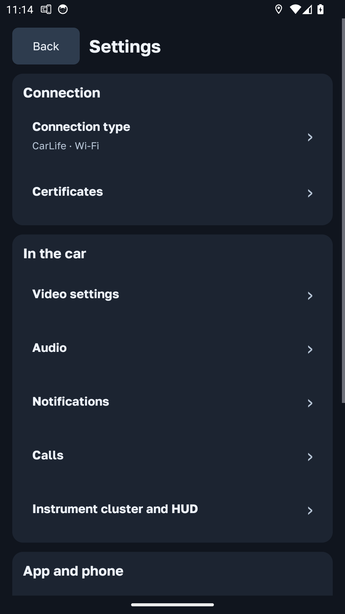
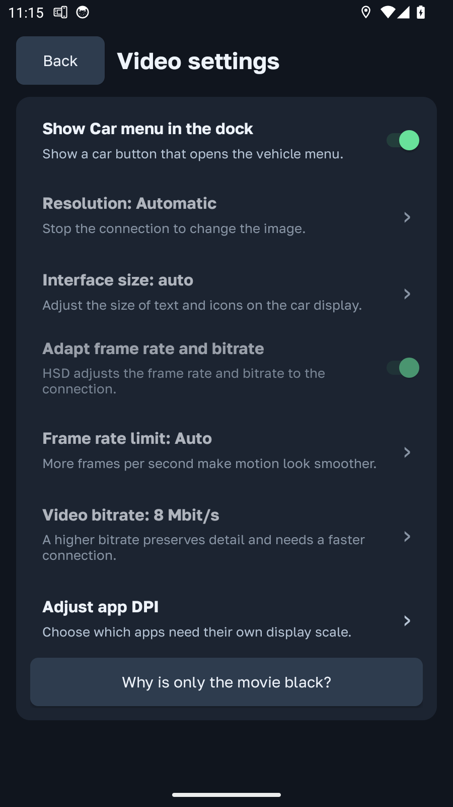
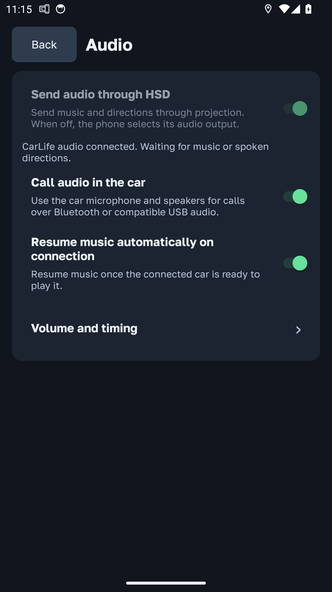

# HSD 0.8.4

[Русский](README.md) · [What changed](#changes) · [Protocols](#connections) · [Setup](#setup)

HSD runs your Android phone’s apps on the car’s built-in display. Open the navigator you already use, switch to your favourite player, or launch an app that is missing from the Android Auto catalogue. Apps and their data stay on the phone. Use the head unit’s touchscreen to control them.

**Android 11 or later** · [Download HSD 0.8.4 (167)](https://github.com/SadykovIV/HSD/releases/download/v0.8.4/HSD-0.8.4-code167.apk) · [Download DriveDeck-HSD 0.7.4 (374)](https://github.com/SadykovIV/HSD/releases/download/v0.8.4/DriveDeck-HSD-0.7.4-code374.apk)

**Android Auto (AA) requires valid AA certificates accepted by the head unit.** Install the ZIP issued to you under **Settings → Certificates → Install from ZIP**. Select the installed profile in Android Auto mode and tap **Save**.

**Choose your desktop.** DriveDeck has a dock for favourite apps and a two-window layout so you can keep your map next to your player. Android Desktop provides a separate display for phone apps. Samsung DeX is available on compatible Samsung phones. The CarBridge profile requires a compatible dashboard app installed separately.

## The car screen and the phone

The first images are 1280 × 720 video frames decoded by a software head unit over wireless CarLife. The phone screenshots below show HSD on Android 14. Both APKs came from this release. Select an image to see it at full size.

| Two phone apps side by side | DriveDeck app drawer |
| --- | --- |
|  |  |

View the built-in DriveDeck phone

| DriveDeck’s built-in phone |
| --- |
|  |

| Connected to the head unit | Choosing a connection | Settings overview |
| --- | --- | --- |
|  |  |  |

View picture and audio settings

| Picture settings | Music and hands-free calls |
| --- | --- |
|  |  |

## What changed in HSD 0.8.4 and DriveDeck 0.7.4

1. **More ways to connect**. Wired WeLink, USB and Wi-Fi CarbitLink / EasyConnection, and experimental ICCOA Carlink are now available. DriveDeck can use these modes on head units that offer them. Wired ICCOA tests covered video, touch, cover art and instrument cluster directions. Wireless tests covered discovery and pairing.
2. **Android Auto restores the picture after the camera**. Audio could keep playing while the screen stayed black after the car menu or reversing camera. When the head unit gives the display back to Android Auto, HSD now restores the desktop in the same session.
3. **Calls from the car screen**. DriveDeck’s Phone screen offers a keypad, contacts, favourites and recent calls when the phone is unlocked and Android grants access. Accept or decline an incoming call on the head unit. For messenger calls, the available controls depend on the actions the app supplies to Android.
4. **Notifications you can act on**. New messages appear in the centre. Swipe down anywhere along the top edge to open the shade where the gesture began. Expand a notification, use the app’s actions or reply inline if the app supports it. The handle can be moved or hidden.
5. **Reconnecting wired Android Auto**. Android Auto distinguishes an unplugged cable from a temporary switch to the car menu. If the connection is lost, HSD sends the player a pause command. When the cable is plugged back in, HSD reopens the connection and checks whether Android has already granted USB access.
6. **Hands-free calls independently of music**. Audio settings now have a separate call-audio switch. On Android 12 and later, calls can use the car’s Bluetooth hands-free profile or a USB device that Android recognises as having both a microphone and speakers. Music can use a different output.
7. **Music and spoken directions**. CarPlay handles the brief delays in phone audio that caused gaps in music and guidance. When Bluetooth is selected for music, HSD no longer requests a music channel from the CarPlay receiver. Wired CarLife sends the player a pause command as soon as the cable is unplugged.
8. **More responsive maps**. On the wired CarLife bench, median touch-to-picture latency under load was 147 ms after this change, down from 161 ms in the same test. In WeLink, bench tests covered pinch-to-zoom followed by a one-finger drag. Android Auto touch mapping at the edges of the display was also reworked.
9. **CarbitLink after a call and at the start of a trip**. The car button sends projection to the background and keeps music playing. After a call the head unit can reopen the same desktop and resume touch. For Wi-Fi, select the car’s Bluetooth device. When it connects, HSD waits up to five minutes for EasyConnection and can request a hotspot on Android 16 and later if the system allows it.
10. **Reopening wired CarbitLink**. If the head unit sends data from the previous USB connection on re-entry, HSD retries. A compatible receiver can now reopen the desktop from its own menu with the cable still plugged in.
11. **Picture recovery in CarLife**. After a video restart, the receiver gets a fresh full frame even on a stationary map. A wireless CarLife receiver can also reopen an interrupted channel.
12. **Wireless CarPlay at the start of a trip**. HSD can start connecting when the phone joins the car’s selected Bluetooth device. Enable this for your car. If Android restricts background launches, tap the notification to continue.
13. **Picture size and interface scale**. The HSD home screen shows the actual CarLife session resolution. You can adjust resolution, interface scale, frame rate and bitrate manually. This lets you change button size independently of picture sharpness, within the head unit’s capabilities.
14. **Directions and music on the instrument cluster**. Android Auto now handles the distance to a manoeuvre alongside the arrow and street name more reliably. CarLife handles cover art that arrives shortly after the track title. The car determines what its instrument cluster or head-up display can show.
15. **DriveDeck widgets and navigation**. Tapping the cover opens the active player when that option is enabled. NavRadio+ can show the station name, frequency and logo. Pinned dock apps launch correctly, the optional Home button works inside the dialer, and you can hide the car button.
16. **Keyboard and phone-screen dimming**. DriveDeck’s Display → Keyboard setting lets you choose the phone or head unit for text entry. Reconnect to apply the change. The head unit’s on-screen keyboard requires support from Android. Touching the head unit now preserves HSD’s phone-screen dimming.
17. **Installing Android Auto certificates**. HSD has one place to install an issued ZIP manually. Android Auto mode lists installed profiles and shows which is selected. You can inspect certificate details and assign a separate profile to each head unit.
18. **First-time setup and settings**. The wizard guides you through desktop selection, permissions and activation. Wi-Fi activation can reuse an existing pairing. Picture, audio, phone screen and maintenance settings now include short explanations below their names.
19. **Speed warnings and OBD in DriveDeck**. Choose how far over the speed limit you can go before a warning sounds, from 0 to 20 km/h. If another DriveDeck process is using the OBD adapter, the app explains the wait and retries.
20. **Less repeated work on the phone**. HSD processes fewer duplicate frames when the picture is still and makes fewer temporary copies of audio and video data. In-car battery life was not measured.

## Head unit compatibility

| Head unit mode | How to connect | What to know |
| --- | --- | --- |
| Android Auto (AA) | USB, Bluetooth + Wi-Fi, or LAN | Requires a valid AA certificate. The phone or the head unit can act as the LAN server. |
| Baidu CarLife | USB or Wi-Fi | Choose the wired or wireless CarLife mode offered by your head unit. |
| Apple CarPlay | Bluetooth + Wi-Fi or USB | Wired mode is experimental. It requires the correct USB role, iAP2 and USB NCM networking on the head unit. |
| WeLink (Mapbar A1) | USB | Requires a compatible WeLink receiver. |
| CarbitLink / EasyConnection | USB or Wi-Fi | Experimental. Join the head unit’s Wi-Fi or use the phone’s hotspot. Music uses the car’s Bluetooth connection. |
| Huawei HiCar | Bluetooth + Wi-Fi or USB (NCM) | Experimental. Wired use requires a head unit that supports USB NCM. |
| ICCOA Carlink | USB, car hotspot or Wi-Fi Direct | Experimental. Wired video and touch, and wireless discovery and pairing, were verified on the bench. Wireless projection on a factory head unit still needs confirmation. |

## First connection

1. Install HSD and DriveDeck-HSD from this release on the phone.
2. Open HSD, choose a desktop and follow the wizard. It requests permissions in order and shows the available activation methods.
3. Under **Connection type**, select a mode offered by your head unit. For Android Auto, install and select a valid AA certificate.
4. Open the matching mode on the head unit. Use its projection USB port for wired connections, or follow the selected mode’s wireless setup. Tap **Connect**. If Android asks which app should open the USB device, select **HSD**.

**Updating an existing install.** Install both official APKs over the installed apps. Packages signed with the same key retain their settings. If Android reports a signature conflict, save any data you need before removing the old install. Run activation again after the update if HSD prompts you.

On Android 11–12, touch control while the phone is locked depends on its firmware and the app. The **Phone screen → Dim screen** option is available. Players that need Android’s permission to share audio can use **Settings → Audio → Share app audio** for the current session.

## Community and credits

Thanks to YegorkaPomidorka for the Baidu CarLife implementation, RotkivKiv for DriveDeck, and the Android Auto and CarPlay contributors.

[4PDA discussion](https://4pda.to/forum/index.php?showtopic=1129468) · [Telegram community](https://t.me/+H2QUrHMGm-g3ODhi) · [Support the project](https://pay.cloudtips.ru/p/41f6ecdd)
