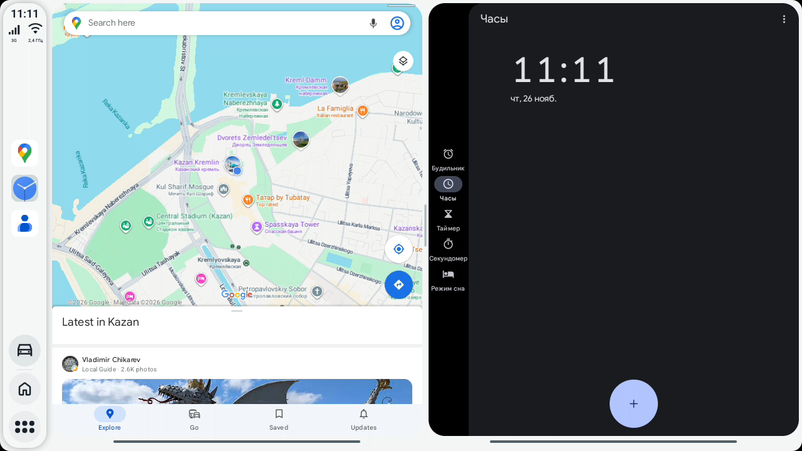
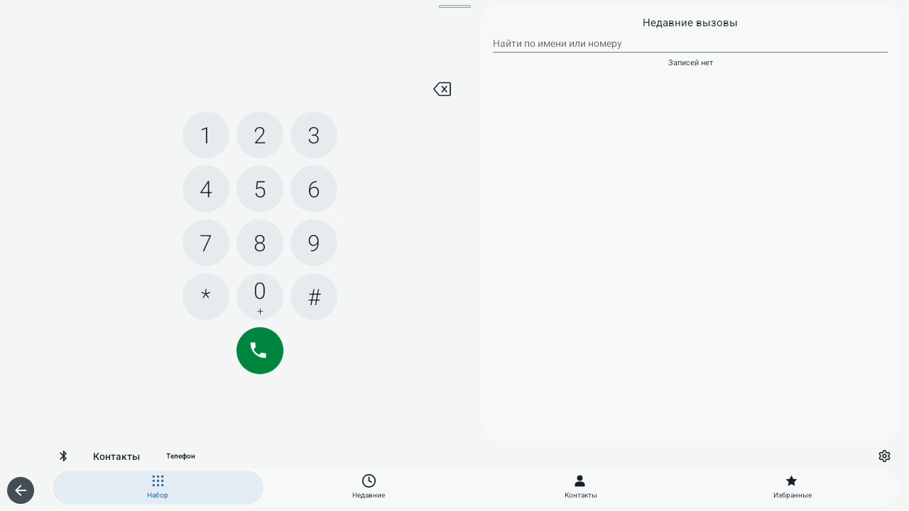
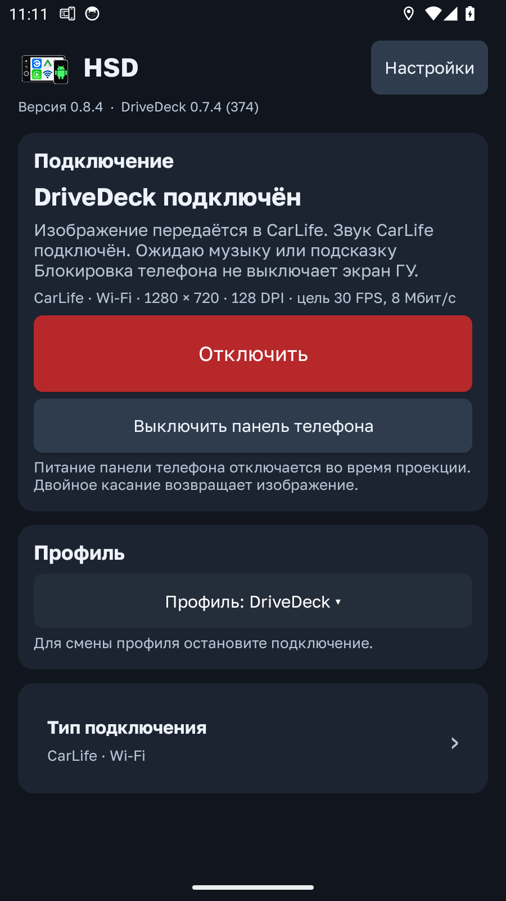
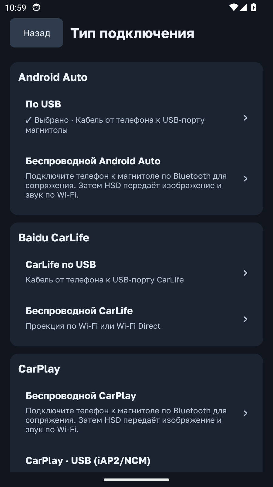
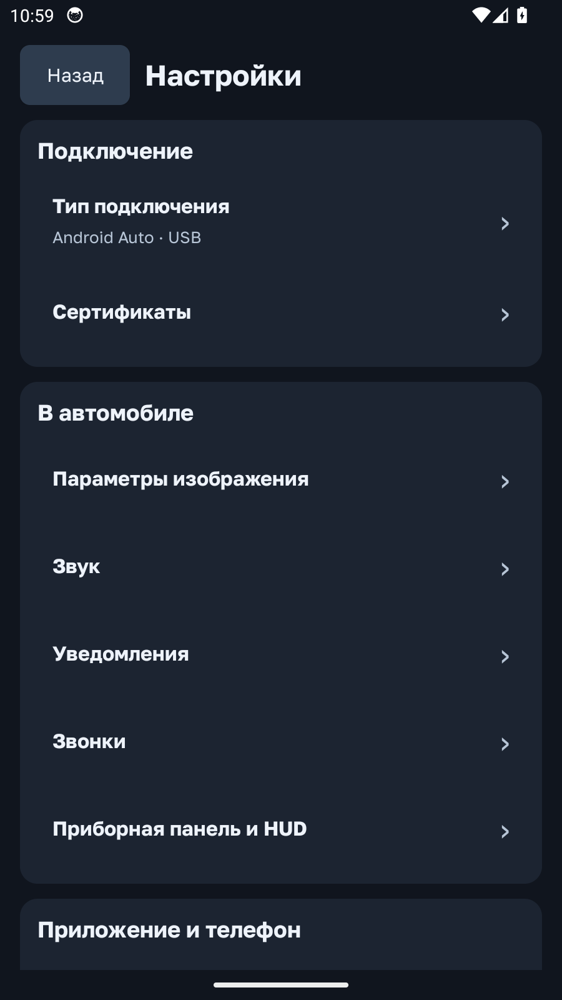
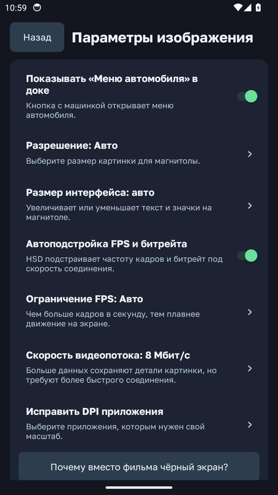
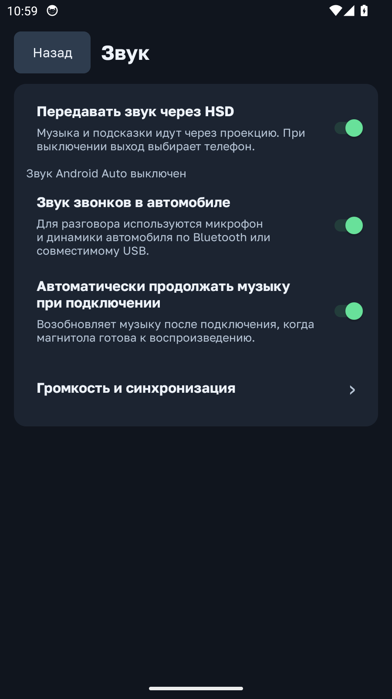

# HSD 0.8.4

[English](README.en.md) · [Изменения](#changes) · [Протоколы](#connections) · [Как подключиться](#setup)

HSD запускает приложения вашего Android-телефона на штатном экране автомобиля. Можно открыть навигатор, которым вы уже пользуетесь, переключиться на свой плеер или запустить приложение, которого нет в каталоге Android Auto. Приложения и их данные остаются на телефоне, а управлять ими можно с сенсорного экрана магнитолы.

**Android 11 и новее** · [Скачать HSD 0.8.4 (167)](https://github.com/SadykovIV/HSD/releases/download/v0.8.4/HSD-0.8.4-code167.apk) · [Скачать DriveDeck-HSD 0.7.4 (374)](https://github.com/SadykovIV/HSD/releases/download/v0.8.4/DriveDeck-HSD-0.7.4-code374.apk)

**Для работы Android Auto (AA) требуются действительные сертификаты AA, которые принимает магнитола.** Выданный вам ZIP установите в **Настройки → Сертификаты → Установить из ZIP**. В режиме Android Auto выберите установленный профиль и нажмите **Сохранить**.

**Выберите рабочий стол.** В DriveDeck есть боковая панель с избранными приложениями и режим двух окон. Например, карту можно оставить открытой рядом с плеером. Android Desktop даёт отдельный экран для приложений телефона. На совместимых Samsung доступен Samsung DeX. Профиль CarBridge можно выбрать, если отдельно установлена совместимая панель.

## Как выглядит в автомобиле и на телефоне

Верхние кадры получены программной магнитолой по беспроводному CarLife в разрешении 1280 × 720. Ниже — снимки HSD на телефоне с Android 14. На стенде установлены оба APK этого выпуска. Нажмите на любой снимок, чтобы открыть его в полном размере.

| Два приложения рядом | Каталог приложений DriveDeck |
| --- | --- |
|  |  |

Посмотреть встроенный телефон DriveDeck

| Встроенный телефон DriveDeck |
| --- |
|  |

| Подключение к магнитоле | Выбор типа подключения | Разделы настроек |
| --- | --- | --- |
|  |  |  |

Посмотреть настройки изображения и звука

| Параметры изображения | Музыка и громкая связь |
| --- | --- |
|  |  |

## Что изменилось в HSD 0.8.4 и DriveDeck 0.7.4

1. **Больше способов подключиться**. Добавлены WeLink по USB, CarbitLink / EasyConnection по USB и Wi-Fi и экспериментальный ICCOA Carlink. Теперь DriveDeck можно попробовать и на магнитолах, у которых для связи с телефоном есть один из этих режимов. Для ICCOA на стенде по USB проверили изображение, касания, обложки и подсказки для приборной панели. По Wi-Fi проверили поиск и сопряжение.
2. **Android Auto возвращает изображение после камеры**. При возвращении из штатного меню или с камеры звук мог продолжаться, а экран оставался чёрным. Теперь, когда магнитола снова открывает Android Auto, HSD возобновляет показ рабочего стола в том же сеансе.
3. **Звонки с экрана автомобиля**. Во встроенном «Телефоне» DriveDeck доступны набор номера, контакты, избранное и недавние вызовы, при разблокированном телефоне и с разрешения Android. Входящий можно принять или отклонить на экране магнитолы. Для звонков из мессенджеров доступны действия, которые само приложение передаёт Android.
4. **Уведомления, с которыми можно работать**. Новые сообщения появляются по центру. Свайпните вниз из любой точки верхнего края, чтобы открыть шторку под пальцем. Карточку можно развернуть, нажать кнопку приложения или ответить прямо из неё, если приложение поддерживает быстрый ответ. Верхнюю полоску можно передвинуть или скрыть.
5. **Повторное подключение Android Auto по USB**. Android Auto различает отключение кабеля и временный уход в меню автомобиля. При настоящем обрыве HSD отправляет проигрывателю команду паузы. При быстром возврате кабеля приложение заново открывает соединение и учитывает уже выданный Android доступ к USB.
6. **Громкая связь отдельно от музыки**. В разделе «Звук» появился переключатель «Звук звонков в автомобиле». На Android 12 и новее разговор можно направить на автомобильный профиль звонков Bluetooth или на распознанное системой USB-устройство с микрофоном и динамиками. Для музыки можно выбрать другой выход.
7. **Музыка и голосовые подсказки**. В CarPlay исправлены пропуски, возникавшие при задержках звука на телефоне. Если для музыки выбран Bluetooth, HSD больше не запрашивает музыкальный канал у приёмника CarPlay. В проводном CarLife при снятии кабеля команда паузы уходит плееру сразу.
8. **Более отзывчивая карта**. В проводном CarLife при одновременной передаче изображения и звука в парном тесте медиана времени от касания до изменения картинки составила 147 мс после доработки и 161 мс до неё. В WeLink на стенде проверили масштабирование двумя пальцами и ведение карты одним пальцем после него. В Android Auto доработано попадание в кнопки по краям экрана.
9. **CarbitLink после звонка и при начале поездки**. Кнопка с машинкой сворачивает проекцию и сохраняет музыку. После разговора магнитола может открыть тот же рабочий стол и снова принимать касания. Для Wi-Fi можно выбрать Bluetooth автомобиля. При соединении с ним HSD ждёт EasyConnection до пяти минут и на Android 16 и новее может запросить включение точки доступа, если это разрешено системой.
10. **Возврат в CarbitLink по USB**. Если магнитола при повторном входе присылает данные от прошлого подключения, HSD сам повторяет попытку. На совместимом приёмнике рабочий стол можно снова открыть с магнитолы, оставив кабель на месте.
11. **Возврат картинки в CarLife**. После перезапуска видео магнитола снова получает полный кадр, даже если на экране неподвижная карта. По Wi-Fi она также может заново открыть прерванный канал.
12. **Беспроводной CarPlay в начале поездки**. HSD может начать подключение, когда телефон соединяется с выбранным Bluetooth автомобиля. Можно разрешить запуск для своей машины. Если Android ограничивает фоновый запуск, продолжить можно нажатием на уведомление.
13. **Разрешение и размер интерфейса**. В CarLife на главном экране HSD отображается размер видео текущего сеанса. Разрешение, размер интерфейса, частоту кадров и битрейт можно подобрать вручную. Размер кнопок и чёткость картинки можно настроить отдельно с учётом возможностей магнитолы.
14. **Подсказки и музыка на приборной панели**. В Android Auto доработана передача расстояния до манёвра вместе со стрелкой и улицей. В CarLife исправлена отправка обложки, когда плеер отдаёт её чуть позже названия трека. Что именно появится на приборной панели или HUD, определяет автомобиль.
15. **Виджеты и навигация в DriveDeck**. Нажатие на обложку открывает играющий плеер, если включена эта настройка. Для NavRadio+ отображаются название, частота и логотип станции. Исправлены запуск закреплённых приложений из дока и возврат из звонилки кнопкой «Домой», если она включена в настройках. Кнопку с машинкой можно скрыть.
16. **Клавиатура и затемнение телефона**. В DriveDeck откройте «Отображение → Клавиатура», чтобы выбрать ввод на телефоне или на магнитоле. Выбор применяется после переподключения, если Android поддерживает клавиатуру на внешнем дисплее. В режиме HSD «Затемнять экран» касания магнитолы сохраняют затемнение телефона.
17. **Установка сертификатов Android Auto**. В HSD есть единое место для ручной установки ZIP. В режиме Android Auto видны установленные профили и текущий выбор. Можно посмотреть сведения о сертификате и назначить отдельный профиль для каждой магнитолы.
18. **Первый запуск и настройки**. Мастер по очереди проводит через выбор рабочего стола, разрешения и активацию. При повторной активации по Wi-Fi можно использовать сохранённое сопряжение. Под параметрами изображения, звука, экрана телефона и обслуживания появились короткие пояснения.
19. **Скорость и OBD в DriveDeck**. Можно задать, при каком превышении ограничения скорости прозвучит предупреждение, от 0 до 20 км/ч сверх лимита. Если OBD-адаптер занят другим процессом DriveDeck, приложение показывает причину ожидания и повторяет подключение.
20. **Меньше лишней работы на телефоне**. Когда картинка неподвижна, HSD реже повторяет обработку одного и того же кадра. При передаче звука и видео стало меньше промежуточных копий. Время работы от батареи в автомобиле отдельно не измерялось.

## Как подключается ваша магнитола

| Режим на магнитоле | Подключение | Что учитывать |
| --- | --- | --- |
| Android Auto (AA) | USB, Bluetooth + Wi-Fi или локальная сеть | Нужен действительный сертификат AA. В локальной сети сервером может быть телефон или магнитола. |
| Baidu CarLife | USB или Wi-Fi | Подходит для магнитол с проводным или беспроводным CarLife. |
| Apple CarPlay | Bluetooth + Wi-Fi или USB | Проводной режим экспериментальный. Для него магнитола должна поддерживать нужную роль USB, iAP2 и USB-сеть NCM. |
| WeLink (Mapbar A1) | USB | Требуется совместимый приёмник WeLink. |
| CarbitLink / EasyConnection | USB или Wi-Fi | Экспериментальный режим. По Wi-Fi можно использовать сеть магнитолы или точку доступа телефона. Музыка передаётся через Bluetooth автомобиля. |
| Huawei HiCar | Bluetooth + Wi-Fi или USB (NCM) | Экспериментальный режим. Для кабеля нужна поддержка USB NCM со стороны магнитолы. |
| ICCOA Carlink | USB, точка доступа автомобиля или Wi-Fi Direct | Экспериментальный режим. На стенде по USB проверены изображение и касания, по Wi-Fi — поиск и сопряжение. Беспроводной показ на штатном ГУ пока не подтверждён. |

## Первое подключение

1. Установите на телефон HSD и DriveDeck-HSD из этого выпуска.
2. Откройте HSD, выберите рабочий стол и пройдите мастер. Он по очереди запросит разрешения и покажет доступные способы активации.
3. В разделе **Тип подключения** выберите режим вашей магнитолы. Для Android Auto установите и выберите действительный сертификат AA.
4. Откройте этот же режим на магнитоле. Для кабеля используйте USB-порт проекции, для беспроводной связи следуйте подсказкам выбранного режима. Нажмите **Подключить**. Если Android спросит, каким приложением открыть USB-устройство, выберите **HSD**.

**Если HSD уже установлен.** Обновите оба официальных APK поверх установленных приложений. Сборки с той же подписью сохраняют настройки. Если Android сообщает о конфликте подписи, перед удалением старой установки сохраните нужные данные. После обновления повторите активацию, если HSD её запросит.

На Android 11–12 управление при системной блокировке зависит от прошивки и приложения. При необходимости выберите **Экран телефона → Затемнять экран**. Для плееров, которым нужен системный запрос на захват звука, он доступен в **Настройки → Звук → Разрешить передачу звука приложений** на время сеанса.

## Сообщество и авторы

Спасибо YegorkaPomidorka за реализацию Baidu CarLife, RotkivKiv за DriveDeck и участникам проектов Android Auto и CarPlay.

[Обсуждение на 4PDA](https://4pda.to/forum/index.php?showtopic=1129468) · [Группа в Telegram](https://t.me/+H2QUrHMGm-g3ODhi) · [Поддержать проект](https://pay.cloudtips.ru/p/41f6ecdd)
