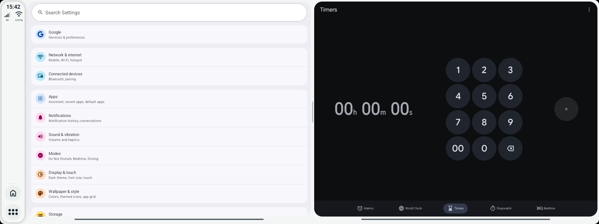

# HSD

[Русский](README.ru.md) · [Download both APKs](https://github.com/SadykovIV/HSD/releases/latest) · [4PDA discussion](https://4pda.to/forum/index.php?showtopic=1129468) · [Telegram group](https://t.me/+H2QUrHMGm-g3ODhi) · [Support via CloudTips](https://pay.cloudtips.ru/p/41f6ecdd)

HSD builds on **[HeadSwap Desktop](https://github.com/SadykovIV/headswap_desk)** and brings **DriveDeck, a full car launcher**, to your head unit. Launch apps installed on your Android phone directly on the car screen, including apps outside the Android Auto catalog. Open an app full screen or keep navigation and a music player side by side. Control them using the head unit’s touchscreen.

| Head unit supports | Connect with |
| --- | --- |
| Android Auto | USB or wireless |
| Baidu CarLife | USB or wireless |
| CarPlay | Wireless |

HSD installs on Android 10 and later. With Android Desktop or DriveDeck, you can turn the phone screen off or let it time out normally. On Android 10–12, the phone firmware and each app determine which windows remain visible and interactive while locked. If an app on the head unit stops updating after the phone locks with a PIN, password or pattern, unlock the phone to resume it. When Android denies playback capture, select Bluetooth audio on the head unit. Samsung DeX is available on compatible Samsung phones.

See how the phone, launcher and head unit exchange video, audio and input. [System diagrams and project map](docs/architecture.md)

**Version 0.8.2:** [Changes since 0.8.1 and Android 10 limitations](docs/releases/0.8.2.md#english).

## Connect your phone

**Upgrading from 0.7.3 or earlier?** Both apps now use Ildar Sadykov’s signing key. Uninstall the old HSD and DriveDeck-HSD, install both APKs from the release, then activate HSD again. Uninstalling erases the apps’ local settings.

1. For an Android Auto connection, select **Automatic** in HSD’s certificate settings. HSD includes a verified identity; installing Google’s Android Auto app is unnecessary. When Internet access is available, HSD checks the public Mgears server for certificate updates and saves a verified package for future connections. You can disable this in the AA certificate settings. If Android Auto is already installed and handles USB instead of HSD, disable it under **Settings → Apps → Android Auto**.
2. Download **HSD** and **DriveDeck-HSD** from the release and install both APKs. Allow your browser or file manager to install unknown apps if prompted. If Google Play Protect blocks installation, you can temporarily turn off app scanning in **Play Store → Profile → Play Protect → Settings** and turn it back on after installation. [Get the APKs](https://github.com/SadykovIV/HSD/releases/latest)
3. Open HSD, grant the permissions requested by the setup wizard and select **DriveDeck**.
4. On Android 10, enable **USB debugging** on the phone used in the car. Install the same HSD APK on a second Android with USB OTG, connect the phones with a data cable, then select **Activate HSD on another phone** on the second phone. Approve debugging on the car phone. Unplug when HSD confirms activation. Repeat after a reboot. For a PC, select **Use a computer**. On Android 11 and later, use a computer or pair over Wi-Fi. For Wi-Fi pairing, connect the phone to a Wi-Fi network. Enable **Wireless debugging** in Developer options. In HSD, open **Settings → Activation → Wi-Fi** and tap **Activate**. HSD reconnects automatically if Android has saved the pairing. For first-time pairing, open **Wireless debugging → Pair device with pairing code** and enter the six digits in the HSD notification while the dialog stays open. On Android 17, after activation succeeds, USB and wireless debugging can be turned off for repeated connections while the activation process remains alive. Rebooting, force-stopping or losing that process may require activation again.
5. On the HSD home screen, select the connection type supported by your head unit. Open the matching mode on the head unit and connect by USB or wirelessly. If Android asks which app should handle USB, choose **HSD**.

## Credits

Thanks to YegorkaPomidorka for the Baidu CarLife implementation, RotkivKiv for DriveDeck, and the Android Auto and CarPlay contributors. [Projects and contributors](CREDITS.md) · [Build from source](BUILDING.md) · [License](LICENSE)
