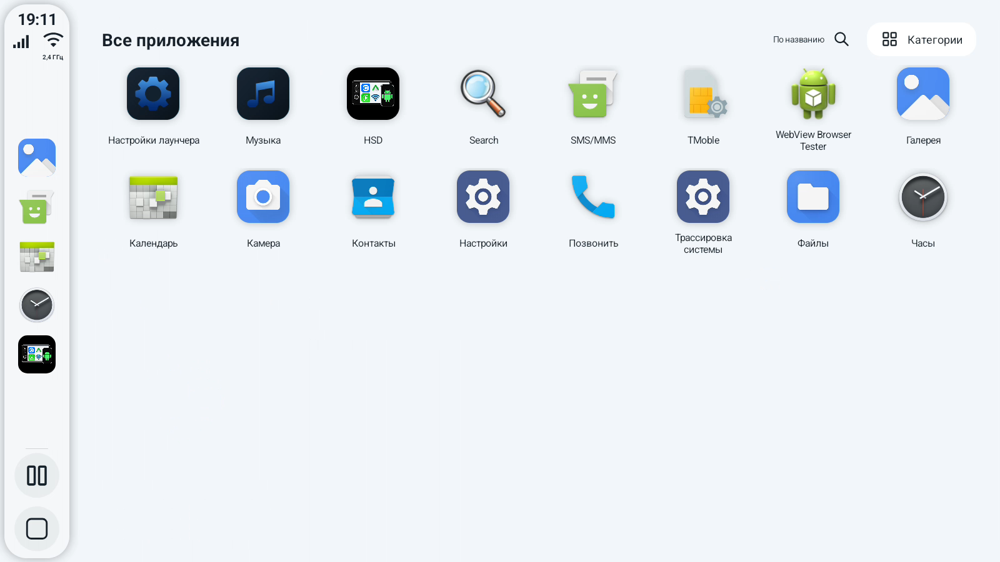
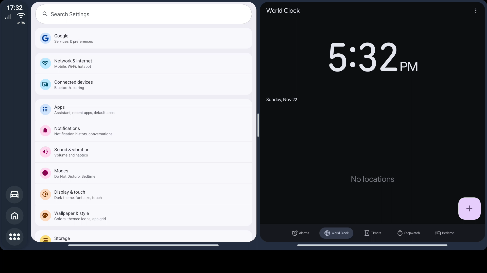
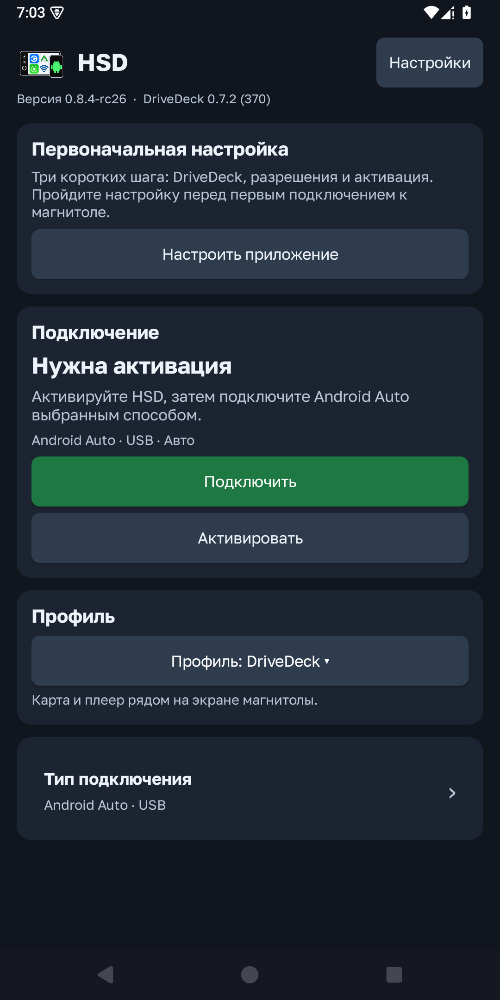
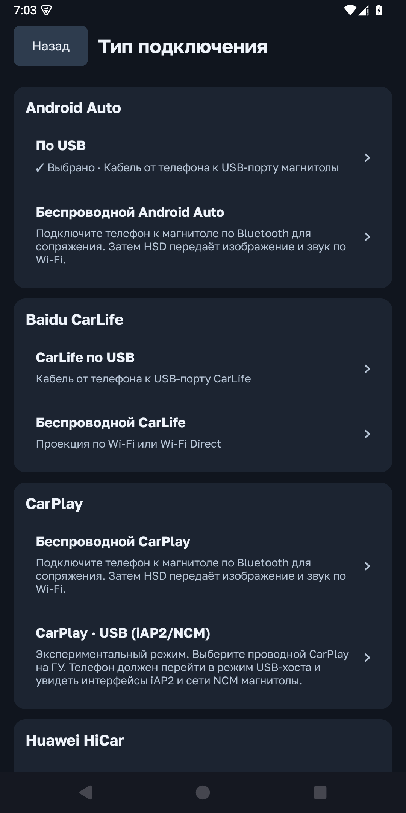
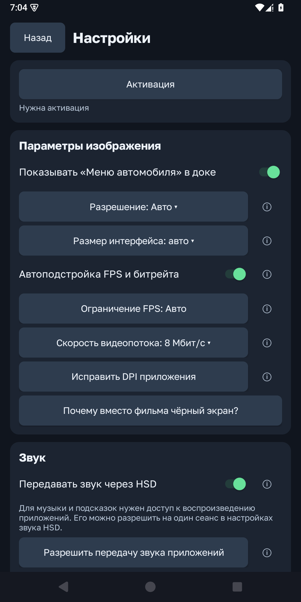
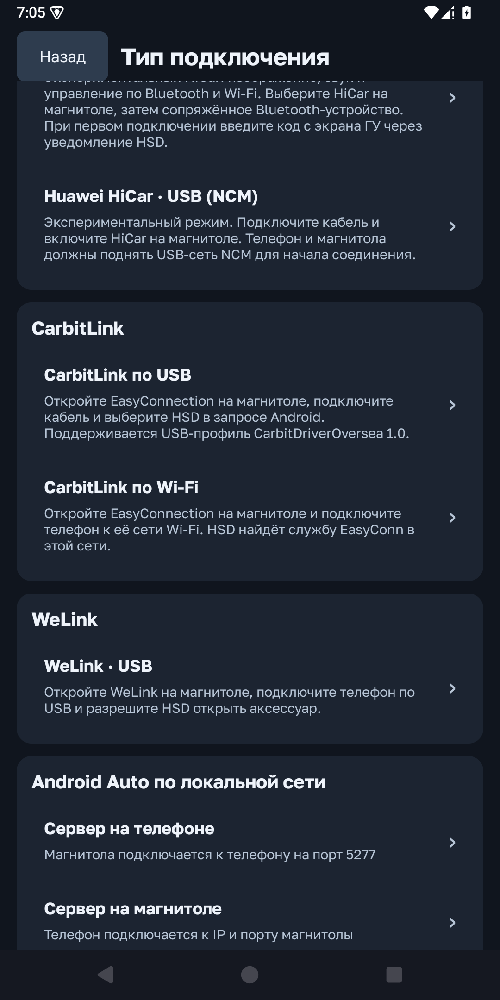

# HSD · HeadSwap Desktop

[English](README.en.md) · [Скачать HSD и DriveDeck](https://github.com/SadykovIV/HSD/releases/latest) · [Обсуждение на 4PDA](https://4pda.to/forum/index.php?showtopic=1129468) · [Группа в Telegram](https://t.me/+H2QUrHMGm-g3ODhi) · [Поддержать через CloudTips](https://pay.cloudtips.ru/p/41f6ecdd)

HSD выводит на экран головного устройства (ГУ) **DriveDeck — полноценный автомобильный лаунчер**. Прямо с экрана ГУ можно запускать установленные на телефоне приложения, в том числе те, которых нет в каталоге Android Auto. Откройте приложение на весь экран или разместите карту и плеер рядом. Касания на магнитоле управляют приложениями телефона.

**Скачать для Android 10 и новее** · [HSD 0.8.3 (115) APK](https://github.com/SadykovIV/HSD/releases/download/v0.8.3/HSD-0.8.3-code115.apk) · [DriveDeck-HSD 0.7.0 (362) APK](https://github.com/SadykovIV/HSD/releases/download/v0.8.3/DriveDeck-HSD-0.7.0-code362.apk)

## Поддерживаемые протоколы

В таблице сравниваются **публичный выпуск 0.8.3 (115)** и **тестовая версия 0.8.4 RC26 (146)**. Для RC26 нужны Android 11 или новее и DriveDeck-HSD 0.7.2 (370).

| Что поддерживает магнитола | HSD 0.8.3 | HSD 0.8.4 RC26 |
| --- | --- | --- |
| Android Auto | USB, Bluetooth + Wi-Fi, локальная сеть | USB, Bluetooth + Wi-Fi, локальная сеть |
| Baidu CarLife | USB, Wi-Fi | USB, Wi-Fi |
| Apple CarPlay | Bluetooth + Wi-Fi | Bluetooth + Wi-Fi, USB¹ |
| Huawei HiCar¹ | Bluetooth + Wi-Fi, USB (NCM) | Bluetooth + Wi-Fi, USB (NCM) |
| CarbitLink / EasyConnection¹ | — | USB, Wi-Fi |
| WeLink (Mapbar A1) | — | USB |

¹ Экспериментальный режим. Проводной CarPlay и CarbitLink проверены на стенде. В CarbitLink музыка идёт по Bluetooth автомобиля. Для проводного HiCar магнитола должна поддерживать USB NCM. Работу WeLink по USB подтвердил владелец Honda SN‑3 с обновлённым приёмником на HSD 0.8.4 RC21.

В локальной сети Android Auto поддерживает два режима — **Сервер на телефоне** и **Сервер на магнитоле**.

## DriveDeck на экране автомобиля

DriveDeck 0.7.2 (370) на тестовом дисплее. В режиме двух окон слева открыты настройки Android, справа — часы. Этот кадр получен по беспроводному Android Auto в HSD 0.8.4 RC26.

| Приложения телефона в DriveDeck | Два приложения рядом |
| --- | --- |
|  |  |

Посмотреть, как выглядит DriveDeck в салоне автомобиля

*Иллюстрация на основе фотографии автора, обработанная с помощью ИИ.*

## HSD на телефоне

Экраны HSD 0.8.4 RC26 с DriveDeck 0.7.2 сняты на эмуляторе Android 15. На главном экране видны версии обоих приложений, в настройках — параметры изображения и звука.

| Главный экран | Тип подключения | Настройки |
| --- | --- | --- |
|  |  |  |

Ещё на экране «Тип подключения» — HiCar, CarbitLink, WeLink и Android Auto по локальной сети

В RC26 при первой установке включены звонки и уведомления на ГУ, звук через HSD, отдельные голосовые подсказки навигатора и управление экраном телефона. Мастер запрашивает системные разрешения по очереди. При повторной активации HSD учитывает сохранённые настройки, в том числе выбор Bluetooth для музыки.

В режимах Android Desktop и DriveDeck экран телефона можно погасить кнопкой или дождаться обычного тайм-аута. На Android 11–12 работа окон при блокировке зависит от прошивки и приложения. Если окно на магнитоле перестало обновляться, разблокируйте телефон. Если Android запросит доступ к звуку приложений, откройте **Настройки → Звук → Разрешить передачу звука приложений**. Разрешение действует один сеанс. Samsung DeX доступен на совместимых телефонах Samsung.

## Как подключиться

1. Установите на телефон **оба APK из одного выпуска**. [Скачать HSD и DriveDeck](https://github.com/SadykovIV/HSD/releases/latest)
2. Откройте HSD, выберите **DriveDeck** и пройдите мастер настройки и активации.
3. На главном экране откройте **Тип подключения** и выберите режим, который поддерживает ваша магнитола. Откройте тот же режим на магнитоле. Для кабеля используйте USB-порт проекции. Если Android предложит выбрать приложение для проводного Android Auto или CarLife, выберите **HSD**.
4. Для проводного HiCar выберите **Huawei HiCar · USB (NCM)**, сохраните выбор, подключите кабель и нажмите **Подключить**.

Если Android Auto требует **выданный вам сертификат**, в 0.8.3 выберите профиль из хранилища Android. В RC26 откройте **Настройки → Сертификаты → Установить из ZIP**, выберите установленный профиль и нажмите **Сохранить**. Для каждой магнитолы можно сохранить свой выбор.

**При обновлении с 0.7.3 или более ранней версии** удалите старые HSD и DriveDeck-HSD перед установкой. Ключ подписи изменился. Удаление сбросит локальные настройки, после установки потребуется повторная активация.

[Что изменилось в 0.8.3](CHANGELOG.md#что-изменилось-с-082) · [Известные ограничения](CHANGELOG.md#ограничения) · [Все выпуски и APK](https://github.com/SadykovIV/HSD/releases)

## Благодарности

Спасибо YegorkaPomidorka за реализацию Baidu CarLife, RotkivKiv за DriveDeck и разработчикам Android Auto и CarPlay.
