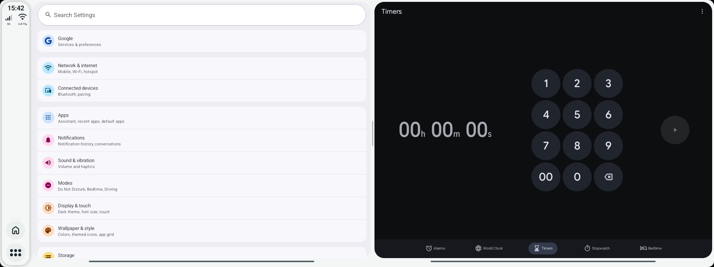
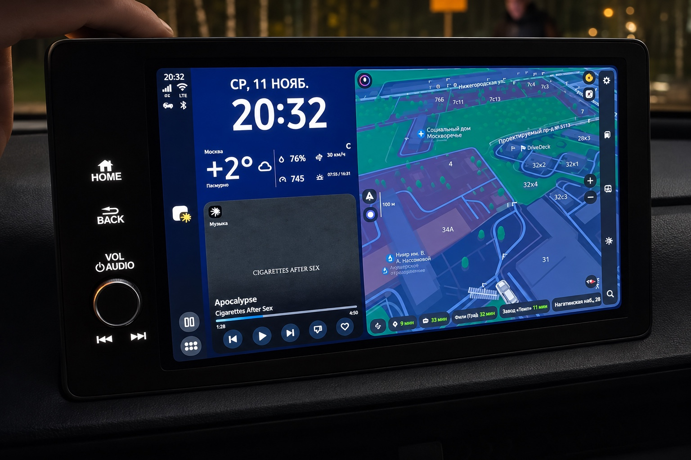
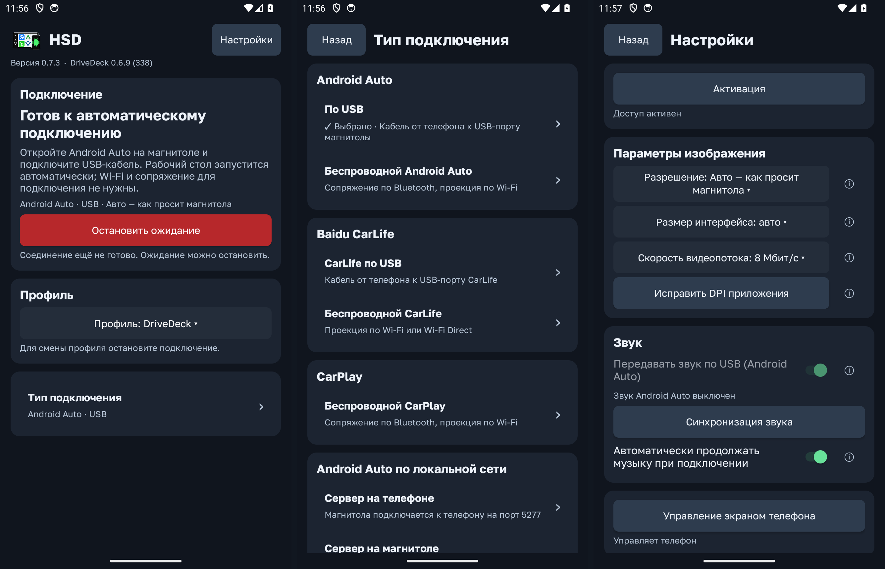

# HSD

[English](README.md) · [Скачать оба APK](https://github.com/SadykovIV/HSD/releases/latest) · [Обсуждение на 4PDA](https://4pda.to/forum/index.php?showtopic=1129468) · [Группа в Telegram](https://t.me/+H2QUrHMGm-g3ODhi) · [Поддержать через CloudTips](https://pay.cloudtips.ru/p/41f6ecdd)

HSD — развитие **[HeadSwap Desktop](https://github.com/SadykovIV/headswap_desk)**. Приложение выводит на экран головного устройства (ГУ) **DriveDeck — полноценный автомобильный лаунчер**. Прямо с экрана ГУ можно запускать установленные на телефоне приложения, в том числе те, которых нет в каталоге Android Auto. Откройте приложение на весь экран или разместите карту и плеер рядом. Касания на магнитоле управляют приложениями телефона.

| Что поддерживает магнитола | Как подключиться |
| --- | --- |
| Android Auto | По USB или без проводов |
| Baidu CarLife | По USB или без проводов |
| CarPlay | Без проводов |

HSD устанавливается на Android 10 и новее. В режимах Android Desktop и DriveDeck экран телефона можно погасить кнопкой или дождаться обычного тайм-аута. На Android 10–12 показ и управление окнами при блокировке зависят от прошивки и приложения. Если после блокировки с PIN, паролем или рисунком окно приложения на магнитоле остановилось, разблокируйте телефон. Если Android не выдаёт право на захват звука, выберите Bluetooth как источник музыки на магнитоле. Samsung DeX доступен на совместимых телефонах Samsung.

Как выглядит DriveDeck в автомобиле

*Иллюстрация на основе фотографии автора, обработанная с помощью ИИ.*

На схемах показано, как телефон передаёт изображение и звук, как касания возвращаются с магнитолы и где искать реализацию. [Схемы и карта проекта](docs/architecture.ru.md)

**Версия 0.8.2:** [Изменения с 0.8.1 и ограничения Android 10](docs/releases/0.8.2.md#русский).

## Как подключиться

**Переходите с 0.7.3 или более ранней версии?** Оба приложения теперь подписаны ключом Ildar Sadykov. Удалите прежние HSD и DriveDeck-HSD, установите оба APK из релиза и заново активируйте HSD. При удалении локальные настройки приложений сбросятся.

1. Для подключения через Android Auto выберите **Автоматически** в настройках сертификатов HSD. В HSD включено проверенное удостоверение; устанавливать штатный Android Auto не требуется. При наличии интернета HSD автоматически проверяет обновления сертификата на публичном сервере Mgears и сохраняет проверенный комплект для последующих подключений. Это можно отключить в разделе сертификатов AA. Если штатный Android Auto уже установлен и перехватывает USB вместо HSD, отключите его в **Настройки → Приложения → Android Auto**.
2. Скачайте из релиза **HSD** и **DriveDeck-HSD** и установите оба APK. Если Android попросит, разрешите браузеру или файловому менеджеру установку из этого источника. Если установку блокирует Google Play Защита, можно временно отключить сканирование в **Google Play → Профиль → Play Защита → Настройки**, а после установки включить его снова. [Скачать APK](https://github.com/SadykovIV/HSD/releases/latest)
3. Откройте HSD, выдайте разрешения, которые запросит мастер настройки, и выберите **DriveDeck**.
4. На Android 10 включите **отладку по USB** на телефоне для автомобиля. Установите тот же APK HSD на второй Android с USB-OTG, соедините телефоны кабелем для передачи данных и выберите на втором **Активировать HSD на другом телефоне**. Подтвердите отладку на основном телефоне. После сообщения об успешной активации отсоедините кабель. После перезагрузки повторите активацию. Для активации с ПК выберите **С компьютера**. На Android 11 и новее можно также активировать HSD по Wi-Fi. Для этого подключите телефон к любой доступной сети Wi-Fi. Включите **Беспроводную отладку** в параметрах разработчика. В HSD откройте **Настройки → Активация → Wi-Fi** и нажмите **Активировать**. Если Android уже сохранил сопряжение, HSD подключится автоматически. При первом сопряжении откройте **Беспроводная отладка → Сопряжение устройства с помощью кода** и введите шесть цифр в уведомлении HSD, оставив окно с кодом открытым. На Android 17 после успешной активации USB- и беспроводную отладку можно выключить: повторные подключения используют живую активацию. Перезагрузка, принудительная остановка или завершение её процесса могут потребовать новой активации.
5. На главном экране HSD выберите **Тип подключения**. Откройте соответствующий режим на магнитоле и подключите телефон по USB или без проводов. Если Android предложит выбрать приложение для USB, укажите **HSD**.

## Благодарности

Спасибо YegorkaPomidorka за реализацию Baidu CarLife, RotkivKiv за DriveDeck и разработчикам Android Auto и CarPlay. [Проекты и авторы](CREDITS.md) · [Сборка из исходников](BUILDING.md) · [Лицензия](LICENSE)
