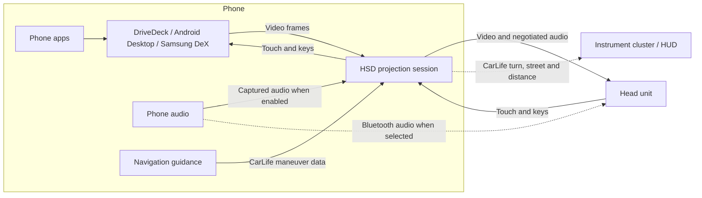
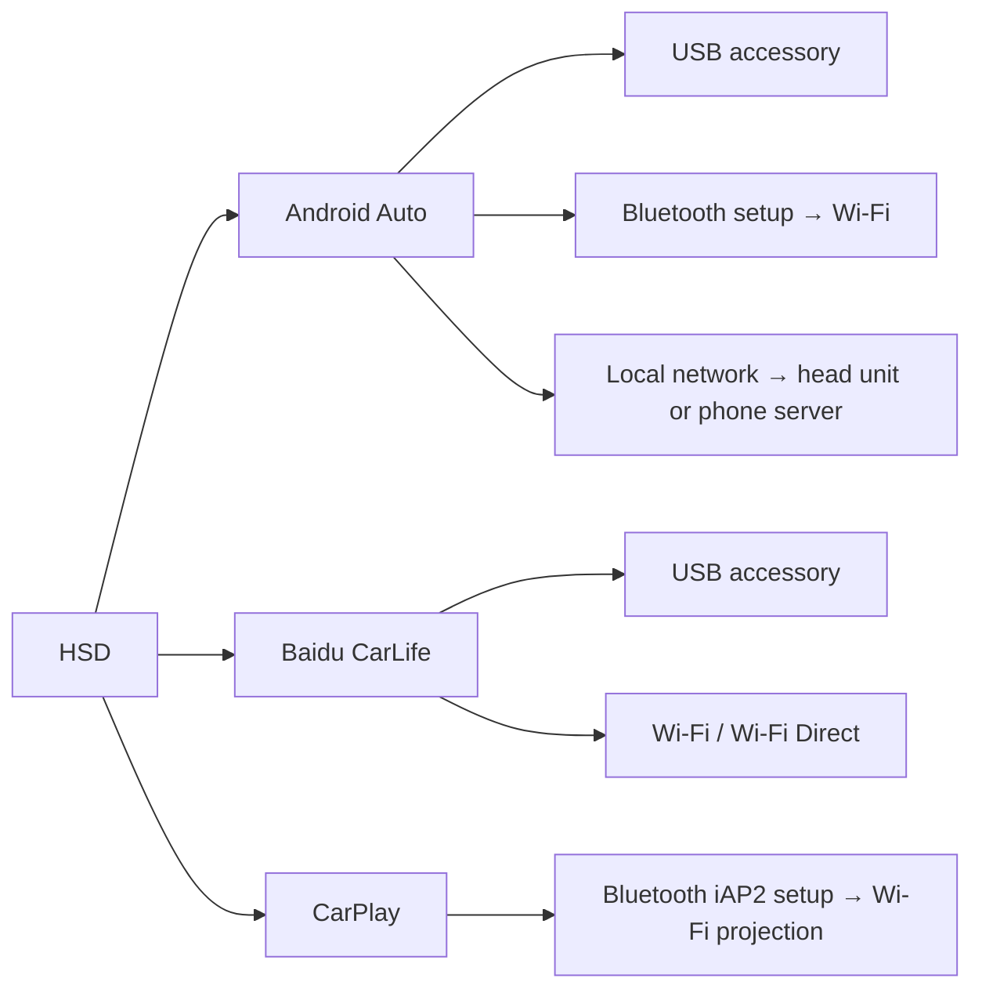

# How HSD works

[Русский](architecture.ru.md) · [Setup](../README.md#connect-your-phone)

## Phone and head unit

The apps run on the phone. The head unit displays the selected desktop. A compatible instrument cluster can subscribe to turn guidance independently of the video and music.

## Connections

## Project map

| Area | Source |
| --- | --- |
| Connection selection and session lifecycle | [ProjectionRoute](../android/app/src/main/java/com/hsd/universal/ProjectionRoute.kt), [AutoService](../android/app/src/main/java/com/hsd/universal/AutoService.kt) |
| Android Auto, CarPlay and CarLife protocol sessions | [AutoProjection](../android/app/src/main/java/com/hsd/universal/AutoProjection.kt), [CarPlayProjection](../android/app/src/main/java/com/hsd/universal/CarPlayProjection.kt), [CarLifeSession](../android/app/src/main/java/com/hsd/universal/CarLifeSession.kt) |
| Android Auto transport and CarLife links | [aap-transport](../android/aap-transport/), [CarLife links](../android/app/src/main/java/com/hsd/universal/link/) |
| Activation, virtual displays, input and audio capture | [Desktop services](../android/app/src/main/java/com/hsd/universal/dex/) |
| DriveDeck companion and external panel API | [Companion](../tools/drivedeck-companion/), [Desktop panel SDK](../sdk/desktop-panel-v1/) |
| Instrument cluster and HUD guidance | [Navigation sources](../android/app/src/main/java/com/hsd/universal/cluster/), [CarLife metadata](../android/app/src/main/java/com/hsd/universal/aa/AaMeta.kt) |
