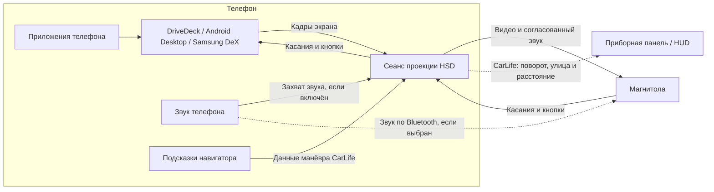
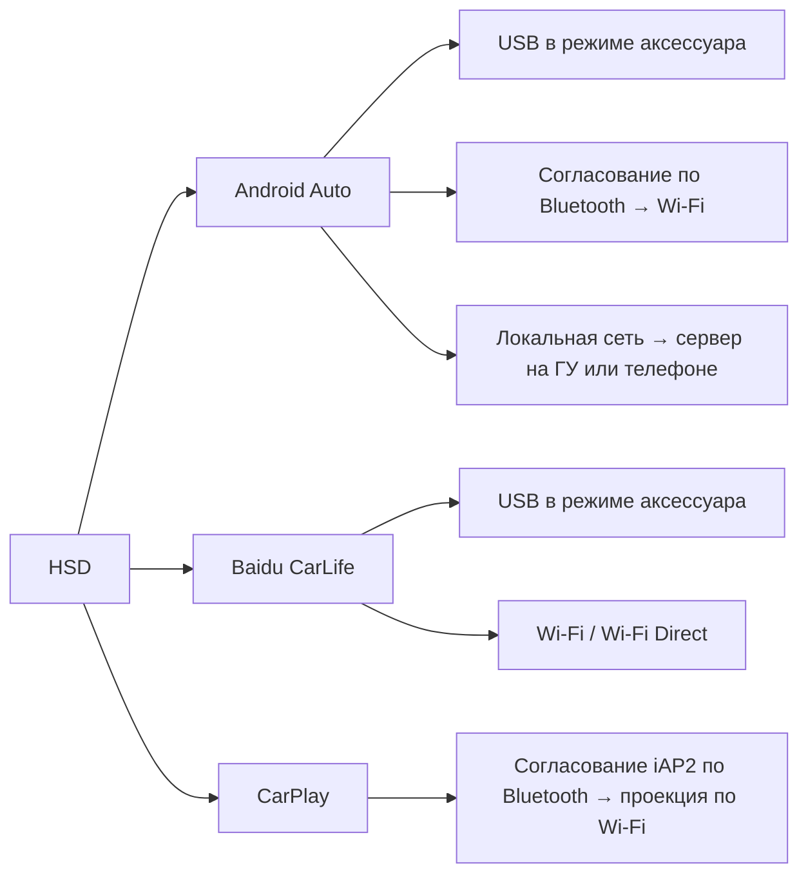

# Как работает HSD

[English](architecture.md) · [Подключение](../README.ru.md#как-подключиться)

## Телефон и магнитола

Приложения работают на телефоне, магнитола показывает выбранный рабочий стол. Совместимая приборная панель может получать подсказки поворотов независимо от видео и музыки.

## Способы подключения

## Карта проекта

| Задача | Исходный код |
| --- | --- |
| Выбор подключения и управление сеансом | [ProjectionRoute](../android/app/src/main/java/com/hsd/universal/ProjectionRoute.kt), [AutoService](../android/app/src/main/java/com/hsd/universal/AutoService.kt) |
| Сеансы Android Auto, CarPlay и CarLife | [AutoProjection](../android/app/src/main/java/com/hsd/universal/AutoProjection.kt), [CarPlayProjection](../android/app/src/main/java/com/hsd/universal/CarPlayProjection.kt), [CarLifeSession](../android/app/src/main/java/com/hsd/universal/CarLifeSession.kt) |
| Сетевой и проводной транспорт | [Android Auto](../android/aap-transport/), [CarLife](../android/app/src/main/java/com/hsd/universal/link/) |
| Описание телефона AA: иконки, модель и стабильный ID независимо от сертификата | [ProjectionDescription](../android/app/src/main/java/com/hsd/universal/ProjectionDescription.kt), [PhoneDescription](../android/aap-transport/src/main/java/net/prototux/aare/aap/PhoneDescription.kt) |
| Профили телефона и сохранённые магнитолы Android Auto | [ProjectionIdentity](../android/app/src/main/java/com/hsd/universal/ProjectionIdentity.kt) |
| Общая временная шкала CarLife и очереди без блокировки аудио ожидающим видео | [DesktopAvTimeline](../android/app/src/main/java/com/hsd/universal/link/DesktopAvTimeline.kt), [StreamTransport](../android/app/src/main/java/com/hsd/universal/link/StreamTransport.kt), [MultiSocketTransport](../android/app/src/main/java/com/hsd/universal/link/MultiSocketTransport.kt) |
| Активация, виртуальные дисплеи, ввод и захват звука | [Службы рабочего стола](../android/app/src/main/java/com/hsd/universal/dex/) |
| Модуль DriveDeck и интерфейс внешних панелей | [Модуль](../tools/drivedeck-companion/), [SDK рабочих столов](../sdk/desktop-panel-v1/) |
| Подсказки на приборной панели и HUD | [Источники навигации](../android/app/src/main/java/com/hsd/universal/cluster/), [Метаданные CarLife](../android/app/src/main/java/com/hsd/universal/aa/AaMeta.kt) |
